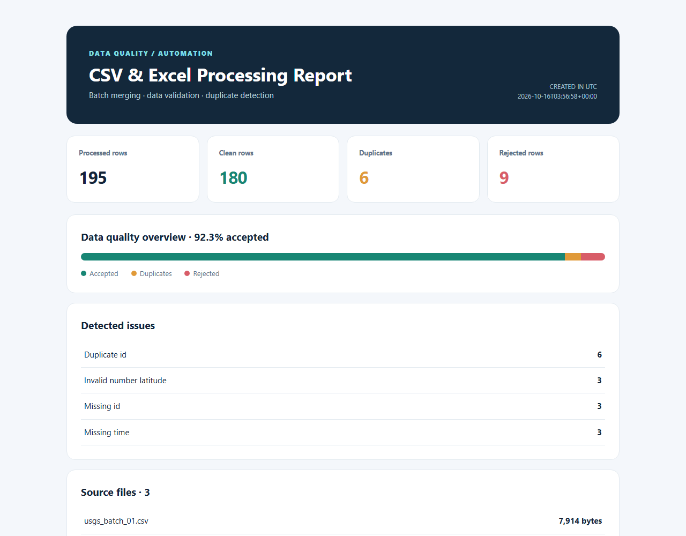
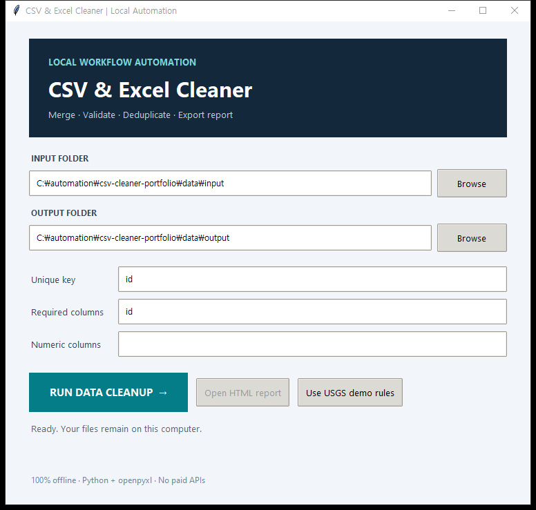

# CSV & Excel Batch Cleaner

**Offline Python automation for merging CSV/XLSX exports, validating records, detecting duplicates, and generating an audit-friendly HTML report.** A small desktop GUI and CLI use the **same processing engine**.



> **Portfolio demonstration.** Real public-domain USGS earthquake data are combined with clearly identified *synthetic duplicates and deliberate errors*. No private client files are included.

## The problem

Manually opening multiple spreadsheet exports, copying rows, checking missing fields, and removing duplicate records is slow and error-prone. This utility processes a folder of files and produces consistent reviewable outputs while preserving the original inputs.

## Features

| Feature | Status |
|---|---|
| Batch import CSV and .xlsx | Supported |
| Mixed CSV/XLSX input folder | Supported |
| First worksheet of each .xlsx | Supported |
| Header normalization and known aliases | Supported |
| Required-field and numeric validation | Supported |
| Case-insensitive deduplication using an ID column | Supported |
| Source filename and original row tracking | Supported |
| Cleaned, duplicate, and rejected CSV **and XLSX** files | Supported |
| Standalone HTML quality report and JSON summary | Supported |
| Windows GUI and scriptable CLI | Supported |
| No cloud uploads or paid APIs | Supported |
| Original Excel styling, formulas, macros, pivot tables | **Not supported** |

**Excel dependency:** only `openpyxl`; no pandas, cloud account or external services.

## Results with real English-language data

The demo begins with **180 real observations** from the U.S. Geological Survey earthquake feed. We intentionally add **6 synthetic duplicates** and **9 synthetic invalid records** to test the quality checks. The program evaluates **195 rows**.

| Outcome | Count |
|---|---:|
| Input files | 3 (2 CSV + 1 XLSX in the mixed demo) |
| Total records | 195 |
| Clean unique records | 180 |
| Duplicates isolated | 6 |
| Invalid records isolated | 9 |
| Automated tests | 19 passing |

**All injected errors are synthetic.** The demo input and output files are not authoritative earthquake observations.



## Install and run

Requires **Python 3.10+**.

```bash
python -m pip install -r requirements.txt
```

On Windows, double-click `run_demo.bat` or run:

```bash
python gui.py
```

1. Select a folder with CSV and/or XLSX files.
2. Select a separate results folder.
3. Set a unique key (default: `id`), required columns, and numeric columns.
4. For the USGS sample only, click **Use USGS demo rules**.
5. Click **Run Data Cleanup**, then **Open HTML report**.

The default rules are general: unique key `id`, required column `id`, and no numeric columns. The USGS demo preset applies strict earthquake-field validation instead.

### CLI

```bash
python cli.py --input data/mixed_input --output data/output --key id \
  --required id,time,latitude,longitude \
  --numeric latitude,longitude,depth,magnitude
```

For another business export, change the input/output directory and validation field names. **Every configured required or numeric column must exist in each source file.** When column names differ, normalize them before processing or add explicit aliases in `cleaner.py`.

### Prepare the mixed demo

```bash
python scripts/prepare_demo.py
python scripts/prepare_mixed_demo.py
```

The sample data and output are included in the repository. Regeneration is optional.

## Outputs

Every run creates a **new subfolder** under the requested output folder, such as `data/output/run_20261016_120000_a1b2c3/`. Existing runs are never overwritten.

| Output | Purpose |
|---|---|
| `cleaned.csv` / `cleaned.xlsx` | Valid unique records |
| `duplicates.csv` / `duplicates.xlsx` | Extra records sharing the same ID |
| `rejected.csv` / `rejected.xlsx` | Records failing required/numeric/CSV-format checks |
| `summary.json` | Processing totals and issue breakdown |
| `report.html` | Visual summary with links to generated outputs |

The original input files are never modified. Results are written to a staging directory first and published as a complete run folder only after every output is created successfully.

## Scope and limitations

- The tool processes only `.csv` and `.xlsx`, not legacy `.xls` or macro-enabled `.xlsm`.
- For each XLSX file it reads the first worksheet. Formulas are **not calculated** and are rejected if present in input data. Data should be exported as values.
- Input Excel formatting, images, and embedded objects are not carried into cleaned output; the utility produces new flat tables.
- The per-file input limit is 20MB and the combined input limit is 100MB. Row results are stored in memory for final export, so very large projects may need a streaming/database approach.
- Duplicate detection uses a single user-selected normalized column; it is not fuzzy matching.
- Empty numeric cells are allowed unless the corresponding column is also marked required.
- A malformed CSV syntax error aborts processing without publishing a partial output folder. Rows with the wrong number of fields are sent to rejected outputs when they can be parsed.
- Header mapping is deterministic, not AI-driven. The small included alias table is designed around the USGS demonstration.
- CSV and XLSX outputs protect text resembling spreadsheet formulas by escaping them.
- Output files are created locally; the app does not contact any remote service.

## Testing

```bash
python -m unittest discover -s tests -v
```

Tests cover CSV/XLSX input, numeric conversion, missing configured columns, duplicate ID detection, invalid CSV syntax, spreadsheet formula safety, output folder isolation, malformed row traceability and validation defaults.

## Repository structure

```text
cleaner.py            shared validation, deduplication and output reporting
spreadsheet_io.py     CSV and XLSX reading / XLSX writing
gui.py                Tkinter frontend
cli.py                command-line frontend
tests/                automated regression tests
scripts/              demo data preparation and GUI screenshot helper
data/source/          preserved original USGS feed snapshot
data/input/           reproducible CSV examples
data/mixed_input/     2 CSV + 1 XLSX examples
data/output/          generated runtime folders (ignored by Git)
data/example_output/  committed output from a successful mixed-format run
assets/               real screenshots of the GUI and report
```

## Source, license and attribution

Example data: **U.S. Geological Survey (USGS), Earthquake Hazards Program**
Data feed: https://earthquake.usgs.gov/earthquakes/feed/v1.0/summary/2.5_month.csv
USGS reuse guidance: https://www.usgs.gov/data-management/data-licensing

See [DATA_SOURCES.md](DATA_SOURCES.md) for licensing context, snapshot date and details of the **synthetic test anomalies**. The source code is licensed under MIT; the USGS data retain their original status and are not relicensed by our MIT license.

This repository is an independent programming portfolio project and is not affiliated with or endorsed by the USGS.
